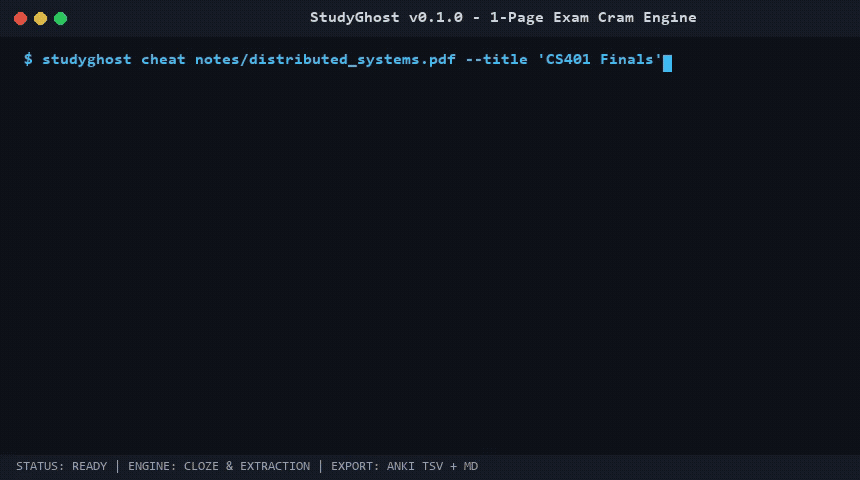

# 👻 StudyGhost

> **Stop reading 80-page slides the night before exams.** Condense messy lecture slides, textbooks, and notes into high-yield **1-page cram sheets**, instant **active recall MCQs**, and **Anki-ready flashcards**.

[](https://github.com/Rishabhraj06/StudyGhost/actions/workflows/ci.yml)
[](https://www.python.org/downloads/)
[](LICENSE)
[](https://streamlit.io)

---

## 🎬 Demo Preview



---

## ⚡ The Problem StudyGhost Solves

Every college student and developer faces the same cycle:
1. **Slide Overload**: Professors dump 60-100 slides full of filler before midterms.
2. **Passive Reading Trap**: Highlighting textbooks gives an illusion of competence, but active recall is what actually passes exams.
3. **Anki Card Friction**: Making 50 flashcards manually takes 2 hours of tedious copy-pasting.

**StudyGhost automates this entire pipeline in under 1 second:**
- 📄 **1-Page CheatSheet**: Isolates core definitions, laws, protocols, and high-yield takeaways.
- 🎯 **Cloze MCQ Simulator**: Synthesizes multiple-choice questions with plausible distractors and instant verification.
- 🗂️ **Anki Exporter**: Exports formatted `.tsv` flashcards ready to import into Anki with zero manual editing.

---

## 🚀 Quickstart

### 1. Installation
```bash
git clone https://github.com/Rishabhraj06/StudyGhost.git
cd StudyGhost
pip install -r requirements.txt
pip install -e .
```

### 2. CLI Usage

#### Generate 1-Page Cheatsheet
```bash
studyghost cheat notes/distributed_systems.pdf --title "CS401 Finals"
```

#### Run Practice MCQ Exam
```bash
studyghost mcq notes/distributed_systems.pdf --count 5
```

#### Export to Anki Flashcard Deck
```bash
studyghost cards notes/distributed_systems.pdf --output cs401_anki.tsv
```

### 3. Launch Interactive Web UI
```bash
streamlit run app.py
```

---

## 🧪 Testing

```bash
python -m pytest tests/ -v
```

---

## 🛡️ Privacy & Offline Guarantee

StudyGhost runs **100% locally on your machine**. Your proprietary course materials, unpublished research, and textbooks are never sent to external third-party cloud APIs.

---

## 👤 Author

**Rishabh Raj**
- GitHub: [@Rishabhraj06](https://github.com/Rishabhraj06)
- Portfolio: [https://github.com/Rishabhraj06](https://github.com/Rishabhraj06)
